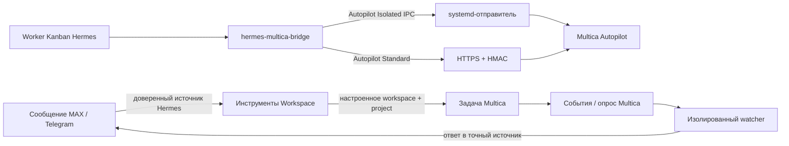

# Важно! Grave! Important!

-   Пролетарии всех стран, соединяйтесь!
-   Workers of the world, unite!
-   Proletoj el ĉiuj landoj, unuiĝu!

# Hermes Multica Bridge

[](https://github.com/teknokomo/hermes-multica-bridge/releases/latest)
[](LICENSE.md)

## Разработчики

Разработано [Текнокомо](https://universo.pro/).

Сделано при поддержке [Консорциума «73-й Меридиан»](https://om73.ru).

## Обзор

`hermes-multica-bridge` — плагин Hermes для двух сценариев работы с Multica: отправки текущей закреплённой (pinned) Kanban-задачи в Autopilot и создания и ведения задач рабочего пространства (Workspace) из доверенного контекста сообщения MAX или Telegram.

Версия 0.2.0 поддерживает два режима безопасности:

- **Стандартный режим (Standard)** — плагин сам отправляет HTTPS-запрос. Несекретная топология хранится в профильном `ConnectionRegistry`, а webhook, HMAC и PAT каждого маршрута — через публичный API учётных данных плагинов Hermes; во время работы они читаются только через `agent.secret_scope`.
- **Изолированный режим (Isolated)** — плагин не получает секреты Multica. Каждый новый маршрут использует отдельный экземпляр systemd-отправителя с активацией по сокету, конфигурацией, принадлежащей root, и учётными данными systemd.

Bridge по умолчанию закрыт: `enabled=false`. Модель не может подменить источник сообщения, выбрать произвольное рабочее пространство или проект, передать учётные данные, URL или путь к вложению.

## Возможности

- инструменты Hermes с узким контрактом:
  - `multica_list_routes` — без аргументов перечисляет только маршруты, разрешённые текущему источнику сообщения и/или закреплённому Kanban-worker;
  - `multica_send_task` — отправляет текущую закреплённую Kanban-задачу и принимает только необязательный `route_id`;
  - `multica_check_task_result` — читает результат только для ранее сохранённой доставки и принимает только необязательный `route_id`;
- маршруты Workspace с инструментами `multica_workspace_send`, `multica_workspace_get`, `multica_workspace_comment` и `multica_workspace_update`;
- автоматическое создание задачи в настроенном рабочем пространстве и проекте и добавление доступных файлов из текущего сообщения Hermes;
- отдельный ограниченный watcher, который получает события Multica и отправляет изменения в точный исходный чат или тред MAX либо Telegram;
- HMAC-SHA256 в заголовке `X-Hub-Signature-256`, рассчитанный по точным отправляемым байтам;
- стабильный `Idempotency-Key` для одной логической версии карточки;
- ограниченное число повторов и локальный журнал SQLite;
- строгая проверка источника HTTPS и пути webhook, запрет перенаправлений и прокси из окружения;
- произвольное число подключений, рабочих пространств и маршрутов в одном профиле Hermes; тестами покрыто не менее 10 маршрутов;
- отдельные учётные данные Standard для каждого маршрута;
- отдельные экземпляры Isolated с собственными сокетом, конфигурацией, состоянием и учётными данными на каждый новый маршрут;
- возврат новых состояний результата в ту же задачу Hermes Kanban в виде комментария без дублей;
- чистое создание профильных хранилищ состояния; неизвестные и прежние внутренние схемы отклоняются без миграции.

## Архитектура



В режиме Isolated отправитель до выполнения внешнего запроса проверяет Linux `SO_PEERCRED` и `SO_PEERPIDFD`, допустимый UID, точный путь Hermes к cgroup конкретной задачи и запуска worker в user-systemd (`user-<uid>.slice/user@<uid>.service/app.slice/...scope`), task ID из launch argv самого Hermes worker, корневой процесс этой cgroup и его непосредственного родителя в точно настроенном systemd-модуле Gateway. Pidfd фиксирует исходный peer и его родителя Gateway на время проверок; после чтения cgroup отправитель повторно сверяет PPID worker и живость родителя. Модельные подпроцессы не проходят эту границу: их PID, parent и launch argv отличаются от доверенного процесса worker.

В текущей архитектуре отдельный ручной allowlist ID каждой карточки по умолчанию не нужен: разрешение относится к **текущей закреплённой задаче Kanban**, которую Hermes уже исполняет. Доверенный контекст включает доску (board), task ID, current run ID, `task_runs.profile`, исполнителя, состояние и записанный Gateway `worker_pid`; задача и запуск обязаны указывать на PID текущего процесса плагина. Политика маршрута ограничивает `source_boards`, профиль и исполнителя, а при необходимости требует точный OperatorGrant `(board, task_id, route_id)`. Standard читает каноническую задачу из закреплённого состояния Kanban, а Isolated дополнительно сверяет `task_id` с неизменённым launch argv worker и `task_id`/`run_id` с точной cgroup worker.

## Доверенные данные сообщения (payload)

Модель может передать только необязательный `route_id` инструментам отправки и получения результата. URL, рабочее пространство, Autopilot, trigger, учётные данные и тело задачи аргументами не принимаются. Bridge читает `HERMES_KANBAN_BOARD`, `HERMES_KANBAN_TASK`, `HERMES_KANBAN_RUN_ID` и закреплённую базу Kanban Hermes, после чего формирует:

```json
{
  "source": {
    "system": "hermes",
    "board": "example-board",
    "task_id": "task-id",
    "run_id": "worker-run-id"
  },
  "task": {
    "title": "Заголовок карточки",
    "body": "Текст карточки"
  }
}
```

`request_fingerprint` исключает `run_id` worker, поэтому повторный запуск worker с той же неизменённой карточкой сохраняет один логический запрос и тот же ключ идемпотентности. Если заголовок или тело карточки изменились после доставки, получение результата завершается ошибкой `request_conflict`.

## Стандартный режим (Standard)

### Настройка

Несекретная топология задаётся через нативное приложение Desktop, раздел **Реестр**:

- подключение (Connection): `connection_id`, имя, `multica_origin`, режим безопасности, общие политики HTTP, ограничения частоты и HMAC;
- рабочее пространство (Workspace): `workspace_key`, `connection_id`, внешний `workspace_id`;
- маршрут (Route): `route_id`, подключение и рабочее пространство, Autopilot, trigger, событие, политика источника, профиля, исполнителя и OperatorGrant, а также отслеживание результата.

Каждый маршрут имеет собственные учётные данные только для записи `webhook|hmac|pat`. Публичный `ctx.credentials` передаёт в Hermes только ID плагина, UUIDv7 маршрута и фиксированный тип учётных данных; Hermes сам вычисляет непрозрачное имя переменной окружения, сохраняет или удаляет значение в выбранной области профиля и возвращает только факт наличия. Показать значение или задать произвольное имя переменной через этот API нельзя.

## Мост рабочих пространств

Маршрут Workspace всегда привязан конфигурацией к одному `workspace_id` и обязательному `project_id`. Инструменты не принимают платформу, автора, чат, тред или message ID в аргументах модели. В целевой сборке Hermes плагин получает эти поля из контекста сессии, привязанного к текущему ходу Gateway, и сверяет `get_session_env()` с `get_bound_session_env()`, чтобы не использовать устаревшие значения переменных процесса. Неполный или несогласованный контекст закрывает операцию до запроса записи в Multica. Маршрут разрешается только при совпадении платформы, user ID и chat ID. Доступ из групп, каналов и тредов отключён, пока оператор явно не включит его в политике.

Шаблон с вырезанными секретами для одного профиля с четырьмя отключёнными маршрутами Workspace и отдельным примером Autopilot находится в [config/registry.om73.example.json](config/registry.om73.example.json). Значения `REPLACE-*` заменяются только в локальной конфигурации.

Маршруты Workspace работают в режиме Standard и имеют отдельные профильные учётные данные Multica PAT. `allowed_assignees` задаётся объектами `{id,type,label}` с типом `member`, `agent` или `squad`; внешний ID должен быть каноническим UUID. `default_assignee` обязан совпадать с разрешённой парой. Строки старого формата загружаются как `member` и показывают предупреждение `legacy_assignee_entry` в `multica_list_routes` и на панели Dashboard. Autopilot продолжает принимать прежние строки Hermes assignee.

`multica_workspace_send` создаёт задачу; родительская задача должна принадлежать тому же рабочему пространству и проекту, а исполнитель подзадачи выбирается из типизированного списка допустимых. ID без типа определяет тип только при единственном совпадении. При отсутствии назначения операция отклоняется до POST, если не передан `allow_unassigned=true`; неназначенная задача возвращает `ok:false`, один раз уведомляет текущий чат через публичный `ctx.post_message()` и не считается начатой работой. Чтение, комментарий и обновление повторно проверяют принадлежность задачи маршруту. При `require_assignee=true` снять назначение нельзя; приглашение участников не поддерживается.

К сообщению автоматически добавляются только файлы из `get_current_attachments()` текущего хода Hermes. Плагин проверяет совпадение платформы, чата, автора и message ID, MIME-тип, расширение, количество и размер. Путь берётся только из доверенного дескриптора Hermes, а не из аргументов модели; файл открывается без перехода по symlink, до и после чтения сверяются идентичность и метаданные. Данные передаются в Multica из памяти, временный файл не создаётся, путь не попадает в ответ или журнал. В этой сборке Hermes изображения не выдаются этим вспомогательным методом и не могут быть прикреплены; маршрут с `require_source_attachment=true` отклонит сообщение, если подходящего файла нет.

Получение контекста сессии и дескрипторов вложений использует внутренний `gateway.session_context` Hermes и отслеживается как `T38-DEBT-3`: после каждого обновления Hermes нужно перепроверить контракт и прогнать регрессионные тесты контекста и вложений. Плагин не требует локальных изменений `register_tool()` или `model_tools` и не передаёт `pass_context`.

Журнал привязывает запись к профилю, маршруту и исходному сообщению. После создания или обновления плагин отдельным GET сверяет состояние с запросом; при несовпадении или недоступности повторного чтения возвращается `assignee_verification_failed`, а повтор делает только GET и никогда второй POST. Подтверждённая операция возвращает сохранённый результат.

После создания задачи плагин записывает метаданные `origin`, `origin_route`, `created_by`, а также HMAC-SHA-256-псевдоним автора и исходного сообщения с ключом, производным от профильного Multica PAT маршрута, без raw user/chat/message ID. `related_issue_ids` проверяется локально и хранится как компактная JSON-строка. Для `test=true` записывается `origin_test=true`; сбой записи метаданных не отменяет задачу и возвращает одно предупреждение `metadata_incomplete`. Неизвестный исход любой записи метаданных автоматически не повторяется.

Watcher — отдельный процесс `hermes-multica-watcher.service` под пользователем `om73-watcher`. Он использует собственный конфиг, принадлежащий root, учётные данные systemd и приватное состояние SQLite; доступа к домашнему каталогу Hermes у него нет. Плагин регистрирует проверенную связь задачи с исходным сообщением через Unix-сокет, UID peer сверяется через `SO_PEERCRED`. Watcher переподключает WebSocket с backoff и дополнительно сверяет задачу и комментарии опросом раз в 30–60 секунд. При первой сверке он подавляет комментарии, созданные до регистрации связи с чатом; дальнейшие новые комментарии и изменения доставляются только при наличии сопоставления (mapping).

Доставка уведомлений фиксирует подтверждённую отправку как `delivered`, доказанный отказ как `not_sent`, потерю ответа после возможной отправки как `delivery_unknown`. Повторяется только явный HTTP 429 при следующей сверке; `delivery_unknown` не повторяется. Отправка в Telegram ограничивается по каждому чату, а прежний лимит MAX сохраняется. Неудачная регистрация сопоставления watcher остаётся в профильном журнале и повторяется при следующих разрешённых операциях Workspace по сохранённым полям источника; `get` никогда не регистрирует задачу из контекста текущего вызывающего сообщения. Если платформа не позволяет ответить в точное исходное сообщение или тред, уведомление не отправляется в родительский чат.

Входящий сценарий Workspace зависит от адаптера целевой сборки, который устанавливает контекст сессии для каждого текущего сообщения. MAX inbound adapter и его корректная привязка источника должны быть проверены отдельно на целевом Gateway. Исходящая доставка от watcher в MAX реализована отдельно.

Среда выполнения плагина вычисляет то же детерминированное имя переменной окружения и читает его только через `agent.secret_scope.get_secret()`. Для одного профиля Hermes поддерживаются несколько независимых подключений и маршрутов Multica.

## Изолированный режим (Isolated)

В режиме Isolated топология маршрута хранится в реестре, а секреты и доверенные параметры ОС и systemd задаёт оператор вне Hermes. Каждый маршрут получает отдельный экземпляр. ID экземпляра детерминированно строится как `r-<route_id без дефисов>`.

При первой установке используются:

```text
hermes-multica-bridge@<instance>.socket
hermes-multica-bridge@<instance>.service
/run/hermes-multica-bridge/<instance>.sock
/etc/hermes-multica-bridge/<instance>.toml
/etc/hermes-multica-bridge/credentials/<instance>/
```

Вспомогательный скрипт оператора:

```bash
sudo python3 /opt/hermes-multica-bridge/deploy/configure_isolated_instance.py \
  --instance <instance-id-из-Route> \
  --route-id <route-id> \
  --connection-id <connection-id> \
  --workspace-key <workspace-key> \
  --route-policy-fingerprint <route-policy-fingerprint>
```

Полную команду с несекретной идентичностью маршрута показывает Desktop. Скрипт проверяет, что `instance` соответствует `route_id`, интерактивно запрашивает секреты с отключённым эхом, создаёт конфигурацию и учётные данные, принадлежащие root, и drop-in сокета для выбранного пользователя ОС Hermes. Общий каталог `/run/hermes-multica-bridge` создаётся socket-модулем как родительский с правами root, а каждый экземпляр получает отдельный сокет. После проверки файлов оператор отдельно выполняет `systemctl daemon-reload` и включает сокет экземпляра.

Подробности: [deploy/README.md](deploy/README.md).

## Интерфейс Hermes

Единый пакет содержит три поверхности:

- `plugin.yaml` + Python plugin — инструменты Autopilot и Workspace для Hermes;
- `dashboard/` — вкладка веб-панели;
- `desktop/plugin.js` — нативная страница Desktop, зарегистрированная через публичные SDK `ROUTES_AREA`/`SIDEBAR_NAV_AREA`.

Нативный Desktop показывает **Обзор**, **Реестр** и **Диагностику** для профиля сфокусированной сессии (с запасным вариантом — профиль Gateway). В Реестре можно создавать несколько подключений, рабочих пространств и маршрутов, задавать точные OperatorGrant, ротировать учётные данные Standard в рамках маршрута и получать команды для конкретного маршрута Isolated.

Серверная часть не разрешает включить маршрут, пока обязательные поля назначения и политики и готовность конкретного маршрута не выполнены. При первом включении маршрута его назначение фиксируется; включённый или уже использованный маршрут нельзя удалить или переназначить, а вывод из эксплуатации выполняется через отключение и пометку об удалении (tombstone). Для Isolated панель выполняет локальную проверку готовности через сокет конкретного маршрута; она не делает HTTP-запрос к Multica и не возвращает значения секретов.

Собственный интерфейс показывает только наличие секретов и безопасные статусы. Защита профиля и поколения не позволяет запоздавшему ответу status/save/credential изменить состояние другого профиля, включая переключение A→B→A.

## HMAC и HTTPS

Для каждого webhook:

1. JSON сериализуется один раз в `raw_body`.
2. HMAC-SHA256 считается по тем же байтам `raw_body`.
3. Передаётся `X-Hub-Signature-256: sha256=<hex>`.
4. Передаётся стабильный `Idempotency-Key`.
5. В HTTP-запросе отправляются именно подписанные байты.

Клиент принимает только HTTPS URL с тем же источником (origin), который задан в `multica_origin`, и допустимым путём webhook Multica. Userinfo, query, fragment, перенаправления и прокси из окружения запрещены. `request_timeout_seconds` задаёт единый монотонный срок для DNS, connect/TLS, заголовков HTTP и чтения тела, а не только отдельные ожидания на сокетах. DNS выполняется в ограниченном фоновом резолвере; одновременно допускается не более четырёх зависших системных запросов, после исчерпания лимита новые запросы завершаются по своему сроку без создания дополнительных потоков резолвера.

HMAC включён по умолчанию. В Standard оператор может явно отключить `hmac_enabled`, после чего остаётся webhook URL с bearer-токеном. Новый маршрут Isolated требует HMAC и fail closed при попытке включить маршрут без него.

## Получение результата

При `result_tracking_enabled=true` нужен отдельный Multica PAT только для чтения.

`multica_check_task_result`:

1. снова получает текущую закреплённую задачу Hermes;
2. находит её запись в журнале;
3. использует только сохранённый при доставке webhook `run_id` и неизменяемый снимок назначения исходного маршрута;
4. читает запуск Multica и связанную задачу с комментариями по сохранённым `multica_origin`/`autopilot_id`, даже если маршрут позже отключён или помечен tombstone;
5. нормализует состояние;
6. упорядочивает изменения одного статуса по монотонной Multica `Issue.revision` и не допускает откат к устаревшему состоянию;
7. при новом состоянии резервирует комментарий в журнале;
8. пока резервирование свежее, не позволяет следующему снимку результата обогнать публикацию комментария;
9. записывает комментарий ограниченного размера в ту же задачу Hermes;
10. подтверждает резервирование только после успешной записи.

Повторная проверка того же результата не создаёт дубликат. Если запись комментария не удалась, резервирование освобождается и следующая проверка может повторить публикацию.

Нормализованные состояния: `pending`, `accepted`, `running`, `succeeded`, `failed`, `skipped`, `unknown`.

Состояние `accepted` в webhook означает только, что Multica приняла доставку и создала запуск. Это не означает завершение задачи.

## Локальный журнал (ledger)

Журнал SQLite хранит только необходимое состояние доставки и результата:

- ключ раздела в рамках маршрута;
- неизменяемый снимок: `route_id`, `connection_id`, `workspace_key`, внешний `workspace_id`, `multica_origin`, `autopilot_id`, `trigger_id`, режим безопасности и отпечаток маршрута и политики;
- идентификаторы request/delivery/run/issue/task;
- состояние отпечатка и идемпотентности;
- состояние попыток и ограничения частоты;
- отпечаток результата и состояние резервирования комментария;
- последнюю серверную ревизию задачи, использованную для упорядочивания снимков результата.

URL webhook, PAT, секрет HMAC и тела секретных ответов в журнале не сохраняются.

## Жизненный цикл конфигурации

Версия плагина — 0.2.0. Реестр принимает текущую каноническую структуру; хранилища состояния создаются с нуля, а несовместимая схема SQLite отклоняется без миграции и внутреннего версионирования.

Переключение Standard ↔ Isolated не переносит секреты автоматически. Новый режим включается только после собственной проверки готовности. При включении маршрута его назначение фиксируется; для другого назначения создаётся новый маршрут, а прежний переводится в отключение и пометку об удалении (tombstone).

## Требования

- Linux с systemd для watcher и отправителя Isolated;
- Python 3.11+;
- Hermes Agent 0.22.4+ с доступными в целевой сборке методами `gateway.session_context.get_bound_session_env`, `get_session_env` и `get_current_attachments`; адаптер MAX и Telegram должен привязывать эти данные к текущему ходу;
- Linux 6.5+, systemd, унифицированные cgroup v2, `SO_PEERCRED` и `SO_PEERPIDFD` только для Isolated;
- HTTPS-эндпоинт Multica;
- Multica PAT для API Workspace и watcher; PAT только для чтения для отслеживания результата Autopilot;
- `websockets` для Multica WebSocket watcher.

## Локальная проверка

Основной офлайн-набор не выполняет живых запросов к Multica и использует фиктивные учётные данные и замоканный HTTP.

```bash
python3 -m unittest discover -s tests -v
node --test tests/test_desktop_profile_guard.mjs tests/test_desktop_registry_ui.mjs
python3 -m compileall -q bridge dashboard deploy tests
```

Релизный контроль также включает Ruff, Bandit, сборку и проверку метаданных пакета, `hermes plugins validate` и `doctor` на чистом staging, `systemd-analyze verify`, поиск секретов и персональных данных, а также проектные Thermos и Autoreview.

## Состояние разработки

Версия продукта — 0.2.0. Это развитие первой версии плагина без внутренних версий реестра, хранилища состояния и API. Установка на сервер, живые записи в Multica, commit и push, публикация выполняются отдельным этапом.

## Лицензия

Проект распространяется по **Omsk Open License / Омской Открытой Лицензии — Базовая модификация. Указание авторства.**

Полный нормативный текст находится в [LICENSE-RU.md](LICENSE-RU.md).

## Совместимость с Hermes

Workspace не требует парного патча ядра Hermes. Чтобы работать с целевой сборкой Hermes, плагин читает контекст источника и текущие дескрипторы вложений через внутренний `gateway.session_context`; этот стык отмечен как `T38-DEBT-3`.

Остаются три ограниченных технических долга: `bridge/hermes.py` использует приватный API Kanban DB только для проверки `worker_pid`, которого нет в `kanban_show`; `dashboard/plugin_api.py` использует `plugins_settings`, потому что маршрут панели не получает `PluginContext`; Workspace использует внутренний контекст сессии Gateway, поскольку инструменты плагина не получают `tool_context`. После каждого обновления Hermes нужно запускать `plugins validate`, `plugins doctor --ci`, тесты `kanban_show`/`kanban_comment`, реестра панели, а также источника и вложений Workspace. Долги снимаются после появления соответствующих публичных API.

Входящий MAX зависит от наличия подходящего адаптера MAX в используемой сборке Hermes.
