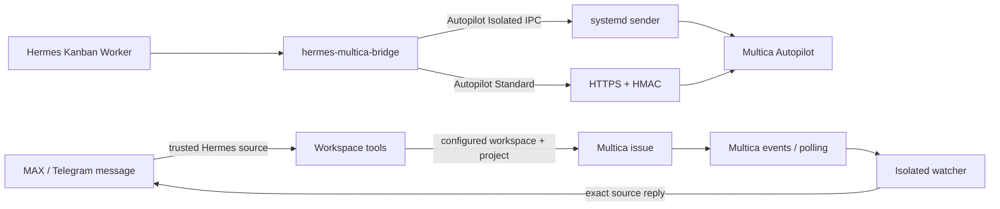

# Hermes Multica Bridge 0.2.0

`hermes-multica-bridge` — плагин Hermes для двух сценариев работы с Multica: отправки текущей pinned Kanban-задачи в Autopilot и создания/ведения Workspace-задач из доверенного контекста сообщения MAX или Telegram.

Версия 0.2.0 поддерживает два режима безопасности:

- **Standard** — плагин отправляет HTTPS-запрос сам. Non-secret topology хранится в профильном `ConnectionRegistry`, а webhook/HMAC/PAT каждого Route — через публичный Hermes plugin credential API и читаются runtime только через `agent.secret_scope`.
- **Isolated** — плагин не получает секреты Multica. Каждый новый Route использует отдельный socket-activated systemd sender instance с root-owned конфигурацией и systemd credentials.

Bridge закрыт по умолчанию: `enabled=false`. Модель не может подменить источник сообщения, выбрать произвольный Workspace/project, передать credentials, URL или путь к вложению.

## Возможности

- инструменты Hermes с узким контрактом:
  - `multica_list_routes` — без аргументов перечисляет только Route, разрешённые текущему источнику сообщения и/или pinned Kanban worker;
  - `multica_send_task` — отправляет текущую pinned Kanban-задачу и принимает только необязательный `route_id`;
  - `multica_check_task_result` — читает результат только для ранее сохранённой delivery и принимает только необязательный `route_id`;
- Workspace-маршруты с инструментами `multica_workspace_send`, `multica_workspace_get`, `multica_workspace_comment` и `multica_workspace_update`;
- автоматическое создание задачи в настроенных Workspace/project и добавление доступных файлов из текущего сообщения Hermes;
- отдельный ограниченный watcher, который получает события Multica и отправляет изменения в точный исходный чат/тред MAX или Telegram;
- HMAC-SHA256 в заголовке `X-Hub-Signature-256`, рассчитанный по точным отправляемым байтам;
- стабильный `Idempotency-Key` для одной логической версии карточки;
- bounded retries и локальный SQLite ledger;
- строгая проверка HTTPS origin и webhook path, запрет redirects и proxy environment;
- произвольное количество Connections, Workspaces и Routes внутри одного Hermes profile; тестами покрыто не менее 10 Routes;
- отдельные Standard credentials на каждый Route;
- отдельные Isolated instances с собственными socket/config/state/credentials на каждый новый Route;
- возврат новых состояний результата в ту же Hermes Kanban-задачу как deduplicated comment;
- чистое создание профильных state stores; неизвестные и прежние внутренние схемы отклоняются без миграции.

## Архитектура



В Isolated mode sender проверяет Linux `SO_PEERCRED` и `SO_PEERPIDFD`, допустимый UID, точный Hermes user-systemd путь task/run-specific worker cgroup (`user-<uid>.slice/user@<uid>.service/app.slice/...scope`), task ID из launch argv самого Hermes worker, корневой процесс этой cgroup и его непосредственного родителя в точно настроенном Gateway systemd unit до выполнения внешнего запроса. Pidfd фиксирует исходный peer и его Gateway parent на время проверок; после чтения cgroup sender повторно сверяет PPID worker и liveness родителя. Модельные subprocess не проходят эту границу: их PID/parent/launch argv отличаются от доверенного worker process.

В текущей архитектуре отдельный ручной allowlist ID каждой карточки по умолчанию не нужен: разрешение относится к **текущей pinned Kanban task**, которую Hermes уже исполняет. Trusted context включает board, task ID, current run ID, `task_runs.profile`, assignee, состояние и записанный Gateway `worker_pid`; task и run обязаны указывать на PID текущего plugin process. Route policy ограничивает `source_boards`, profile/assignee и при необходимости требует точный OperatorGrant `(board, task_id, route_id)`. Standard читает canonical task из pinned Kanban state, а Isolated дополнительно сверяет `task_id` с неизменённым launch argv worker и `task_id`/`run_id` с точной worker cgroup.

## Доверенный payload

Модель может передать только необязательный `route_id` инструментам send/result. URL, Workspace, Autopilot, trigger, credentials и тело задачи аргументами не принимаются. Bridge читает `HERMES_KANBAN_BOARD`, `HERMES_KANBAN_TASK`, `HERMES_KANBAN_RUN_ID` и pinned Kanban DB Hermes, после чего формирует:

```json
{
  "source": {
    "system": "hermes",
    "board": "example-board",
    "task_id": "task-id",
    "run_id": "worker-run-id"
  },
  "task": {
    "title": "Заголовок карточки",
    "body": "Текст карточки"
  }
}
```

`request_fingerprint` исключает worker `run_id`, поэтому повторный worker run той же неизменённой карточки сохраняет один логический запрос и тот же ключ идемпотентности. Если title/body карточки изменились после доставки, result lookup завершается `request_conflict`.

## Standard

### Настройка

Non-secret topology задаётся через native Desktop **Реестр**:

- Connection: `connection_id`, имя, `multica_origin`, security mode, общая HTTP/rate-limit/HMAC policy;
- Workspace: `workspace_key`, `connection_id`, внешний `workspace_id`;
- Route: `route_id`, Connection/Workspace, Autopilot, trigger, event, source/profile/assignee/grant policy и result tracking.

Каждый Route имеет собственные write-only credentials `webhook|hmac|pat`. Публичный `ctx.credentials` передаёт Hermes только plugin ID, UUIDv7 Route и фиксированный credential type; Hermes сам вычисляет opaque env name, сохраняет/удаляет значение в выбранном profile scope и возвращает только presence. Reveal и произвольный env name через этот API отсутствуют.

## Workspace Bridge

Workspace-маршрут всегда привязан конфигурацией к одному `workspace_id` и обязательному `project_id`. Инструменты не принимают `platform`, автора, чат, тред или message ID в аргументах модели. В целевой сборке Hermes плагин получает эти поля из привязанного к текущему Gateway turn session context и сверяет `get_session_env()` с `get_bound_session_env()`, чтобы не использовать устаревшие значения process environment. Неполный или несогласованный контекст закрывает операцию до запроса записи в Multica. Маршрут разрешается только при совпадении платформы, user ID и chat ID. Доступ из групп, каналов и тредов отключён, пока оператор явно не включит его в policy.

Redacted-шаблон одного профиля с четырьмя отключёнными Workspace-маршрутами и отдельным Autopilot-примером находится в [config/registry.om73.example.json](config/registry.om73.example.json). Значения `REPLACE-*` заменяются только в локальной конфигурации.

Маршруты Workspace работают в Standard и имеют отдельные профильные Multica PAT credentials. `allowed_assignees` задаётся объектами `{id,type,label}` с типом `member`, `agent` или `squad`; внешний ID должен быть canonical UUID. `default_assignee` обязан совпадать с разрешённой парой. Legacy-строки загружаются как `member` и показывают `legacy_assignee_entry` в `multica_list_routes` и Dashboard. Autopilot продолжает принимать прежние строки Hermes assignee.

`multica_workspace_send` создаёт issue; parent должен принадлежать тому же workspace/project, а исполнитель подзадачи выбирается из typed allowlist. ID без типа выводит тип только при единственном совпадении. При отсутствии назначения операция отклоняется до POST, если не передан `allow_unassigned=true`; неназначенная issue возвращает `ok:false`, один раз уведомляет текущий чат через публичный `ctx.post_message()` и не считается начатой работой. Чтение, комментарий и обновление повторно проверяют принадлежность issue маршруту. При `require_assignee=true` снимать назначение нельзя; приглашение участников не предоставляется.

К сообщению автоматически добавляются только файлы из `get_current_attachments()` текущего Hermes turn. Плагин проверяет совпадение platform/chat/author/message ID, MIME, расширение, количество и размер. Путь берётся только из доверенного descriptor Hermes, не из аргументов модели; файл открывается без следования symlink, сверяются identity и метаданные до и после чтения. Данные передаются в Multica из памяти, временный файл не создаётся, путь не попадает в ответ или лог. В этой сборке Hermes изображения не выдаются этим helper-ом и не могут быть прикреплены; маршрут с `require_source_attachment=true` отклонит сообщение, если подходящего файла нет.

Получение session context и attachment descriptors использует внутренний `gateway.session_context` Hermes и отслеживается как `T38-DEBT-3`: после каждого обновления Hermes нужно перепроверить контракт и прогнать регрессионные тесты контекста и вложений. Плагин не требует локальных изменений `register_tool()` или `model_tools` и не передаёт `pass_context`.

Ledger привязывает запись к профилю, маршруту и исходному сообщению. После create/update плагин отдельным GET сверяет состояние с запросом; при несовпадении или недоступности readback возвращается `assignee_verification_failed`, а повтор делает только GET и никогда второй POST. Подтверждённая операция возвращает сохранённый результат.

После создания issue плагин записывает metadata `origin`, `origin_route`, `created_by`, а также SHA-256 pseudonym автора и исходного сообщения без raw user/chat/message IDs. `related_issue_ids` проверяется локально и хранится как compact JSON string. Для `test=true` записывается `origin_test=true`; сбой metadata не отменяет issue и возвращает один warning `metadata_incomplete`. Неизвестный исход любой metadata-записи не повторяется автоматически.

Watcher — отдельный процесс `hermes-multica-watcher.service` под `om73-watcher`. Он использует собственный root-owned конфиг, systemd credentials и приватный SQLite state; доступа к Hermes home у него нет. Плагин регистрирует проверенную связь issue с исходным сообщением через Unix socket, peer UID сверяется через `SO_PEERCRED`. Watcher переподключает WebSocket с backoff и дополнительно сверяет issue/comments polling раз в 30–60 секунд. При первой сверке он подавляет комментарии, созданные до регистрации связи с чатом; дальнейшие новые комментарии и изменения доставляются только при наличии mapping.

Доставка уведомлений фиксирует подтверждённую отправку как `delivered`, доказанный отказ как `not_sent`, потерю ответа после возможной отправки как `delivery_unknown`. Повторяется только явный HTTP 429 при следующей сверке; `delivery_unknown` не повторяется. Отправка в Telegram ограничивается по каждому чату, а прежний лимит MAX сохраняется. Неудачная регистрация watcher mapping остаётся в профильном ledger и повторяется при следующих разрешённых операциях Workspace по сохранённым source fields; `get` никогда не регистрирует issue из контекста текущего вызывающего сообщения. Если платформа не позволяет ответить в точное исходное сообщение/тред, уведомление не отправляется в родительский чат.

Входящий Workspace сценарий зависит от adapter-а целевой сборки, который устанавливает session context для каждого текущего сообщения. MAX inbound adapter и его корректная привязка источника должны быть проверены отдельно на целевом Gateway. Исходящая доставка MAX watcher реализована отдельно.

Plugin runtime вычисляет тот же deterministic env name и читает его только через `agent.secret_scope.get_secret()`. Для одного Hermes profile поддерживаются несколько независимых Multica Connections и Routes.

## Isolated

В Isolated mode topology Route хранится в registry, а секреты и доверенные OS/systemd параметры устанавливает оператор вне Hermes. Каждый Route получает отдельный instance. Instance ID детерминированно строится как `r-<route_id без дефисов>`.

Fresh install использует:

```text
hermes-multica-bridge@<instance>.socket
hermes-multica-bridge@<instance>.service
/run/hermes-multica-bridge/<instance>.sock
/etc/hermes-multica-bridge/<instance>.toml
/etc/hermes-multica-bridge/credentials/<instance>/
```

Операторский helper:

```bash
sudo python3 /opt/hermes-multica-bridge/deploy/configure_isolated_instance.py \
  --instance <instance-id-из-Route> \
  --route-id <route-id> \
  --connection-id <connection-id> \
  --workspace-key <workspace-key> \
  --route-policy-fingerprint <route-policy-fingerprint>
```

Полную команду с non-secret Route identity показывает Desktop. Helper проверяет, что `instance` соответствует `route_id`, интерактивно запрашивает секреты с отключённым echo, создаёт root-owned config/credentials и socket drop-in для выбранного Hermes OS user. Общий `/run/hermes-multica-bridge` создаётся socket unit как root-owned parent, а каждый instance получает отдельный socket. После проверки файлов оператор отдельно выполняет `systemctl daemon-reload` и включает instance socket.

Подробности: [deploy/README.md](deploy/README.md).

## Hermes UI

Unified package содержит три поверхности:

- `plugin.yaml` + Python plugin — Autopilot и Workspace инструменты Hermes;
- `dashboard/` — web dashboard tab;
- `desktop/plugin.js` — native Desktop page, зарегистрированная через публичные `ROUTES_AREA`/`SIDEBAR_NAV_AREA` SDK.

Native Desktop показывает **Обзор**, **Реестр** и **Диагностику** для профиля сфокусированной сессии (с fallback на gateway profile). В Реестре можно создавать несколько Connections/Workspaces/Routes, задавать exact OperatorGrants, ротировать route-scoped Standard credentials и получить команды для конкретного Isolated Route.

Backend отклоняет включение Route, пока обязательные destination/policy fields и per-route readiness не готовы. При первом включении Route его destination фиксируется; включённый или уже использованный Route нельзя удалить или перенаправить, а вывод из эксплуатации выполняется через disable + tombstone. Для Isolated dashboard выполняет локальный `readiness` probe через route-specific socket; он не выполняет HTTP-запрос к Multica и не возвращает secret values.

Custom UI показывает только наличие секретов и безопасные статусы. Profile/generation guards не позволяют запоздавшему status/save/credential response изменить состояние другого профиля, включая переключение A→B→A.

## HMAC и HTTPS

Для каждого webhook:

1. JSON сериализуется один раз в `raw_body`.
2. HMAC-SHA256 считается по тем же байтам `raw_body`.
3. Передаётся `X-Hub-Signature-256: sha256=<hex>`.
4. Передаётся стабильный `Idempotency-Key`.
5. В HTTP request отправляются именно подписанные байты.

Клиент принимает только HTTPS URL с тем же origin, который задан в `multica_origin`, и допустимым Multica webhook path. Userinfo, query, fragment, redirects и environment proxies запрещены. `request_timeout_seconds` задаёт один абсолютный monotonic deadline для DNS, connect/TLS, HTTP headers и чтения body, а не только отдельные socket waits. DNS выполняется в bounded daemon resolver; одновременно допускается не более четырёх зависших системных lookup, после исчерпания лимита новые запросы завершаются по своему deadline без создания дополнительных resolver threads.

HMAC включён по умолчанию. В Standard оператор может явно отключить `hmac_enabled`, после чего остаётся bearer webhook URL. Новый Isolated Route требует HMAC и fail closed при попытке включить Route без него.

## Получение результата

При `result_tracking_enabled=true` нужен отдельный read-only Multica PAT.

`multica_check_task_result`:

1. снова получает текущую pinned Hermes task;
2. находит её запись в ledger;
3. использует только сохранённый при webhook delivery `run_id` и immutable destination snapshot исходного Route;
4. читает Multica run и связанную Issue/comments по сохранённым `multica_origin`/`autopilot_id`, даже если Route позже disabled/tombstoned;
5. нормализует состояние;
6. упорядочивает изменения одного статуса по монотонной Multica `Issue.revision` и не допускает stale rollback;
7. при новом состоянии резервирует комментарий в ledger;
8. пока эта reservation свежая, не позволяет следующему result snapshot обогнать публикацию комментария;
9. записывает bounded comment в ту же Hermes task;
10. подтверждает reservation только после успешной записи.

Повторная проверка того же результата не создаёт дубликат. Если запись комментария не удалась, reservation освобождается и следующий check может повторить публикацию.

Нормализованные состояния: `pending`, `accepted`, `running`, `succeeded`, `failed`, `skipped`, `unknown`.

Webhook `accepted` означает только, что Multica приняла доставку/создала run. Это не означает завершение задачи.

## Локальный ledger

SQLite ledger хранит только необходимое состояние доставки и результата:

- route-scoped partition key;
- immutable snapshot: `route_id`, `connection_id`, `workspace_key`, внешний `workspace_id`, `multica_origin`, `autopilot_id`, `trigger_id`, security mode и route/policy fingerprint;
- request/delivery/run/issue/task IDs;
- fingerprint/idempotency state;
- attempts/rate-limit state;
- result fingerprint и состояние comment reservation.
- последнюю серверную Issue revision, использованную для порядка result snapshots.

Webhook URL, PAT, HMAC secret и тела секретных ответов в ledger не сохраняются.

## Lifecycle конфигурации

Плагин имеет версию 0.2.0. Registry принимает текущую каноническую структуру; state stores создаются с нуля, а несовместимая SQLite schema отклоняется без миграции или внутреннего versioning.

Смена Standard ↔ Isolated не переносит секреты автоматически. Новый режим включается только после собственной readiness-проверки. При включении Route его destination фиксируется; для другого destination создаётся новый Route, а прежний переводится в disable + tombstone.

## Требования

- Linux с systemd для watcher и Isolated sender;
- Python 3.11+;
- Hermes Agent 0.22.4+ с доступными в целевой сборке методами `gateway.session_context.get_bound_session_env`, `get_session_env` и `get_current_attachments`; MAX/Telegram adapter должен привязывать эти данные к текущему turn;
- Linux 6.5+, systemd, unified cgroup v2, `SO_PEERCRED` и `SO_PEERPIDFD` только для Isolated;
- HTTPS Multica endpoint;
- Multica PAT для Workspace API и watcher; read-only PAT для Autopilot result tracking;
- `websockets` для Multica WebSocket watcher.

## Локальная проверка

Основной offline набор не выполняет живых Multica запросов и использует fake credentials/mocked HTTP.

```bash
python3 -m unittest discover -s tests -v
node --test tests/test_desktop_profile_guard.mjs tests/test_desktop_registry_ui.mjs
python3 -m compileall -q bridge dashboard deploy tests
```

Release gate также включает Ruff, Bandit, package build/metadata, Hermes plugin validate/doctor на чистом staging, `systemd-analyze verify`, secret/personal-data scan и project Thermos/Autoreview.

## Состояние разработки

Версия продукта — 0.2.0. Это развитие первой версии плагина без внутренних версий Registry, state store или API. Установка на сервер, live-записи в Multica, commit/push и публикация выполняются отдельным этапом.

## Лицензия

Проект распространяется по **Omsk Open License / Омской Открытой Лицензии — Базовая модификация. Указание авторства.**

Полный нормативный текст находится в [LICENSE-RU.md](LICENSE-RU.md).

## Совместимость с Hermes

Workspace не требует парного патча Hermes core. Чтобы работать с целевой custom-сборкой, плагин читает source context и текущие attachment descriptors через внутренний `gateway.session_context`; этот стык отмечен как `T38-DEBT-3`.

Остаются три ограниченных технических долга: `bridge/hermes.py` использует private Kanban DB API только для проверки `worker_pid`, которого нет в `kanban_show`; `dashboard/plugin_api.py` использует `plugins_settings`, потому что dashboard route не получает `PluginContext`; Workspace использует внутренний Gateway session context, поскольку плагинные инструменты не получают `tool_context`. После каждого обновления Hermes нужно запускать `plugins validate`, `plugins doctor --ci`, тесты `kanban_show`/`kanban_comment`, Dashboard registry и Workspace source/attachment. Долги снимаются после появления соответствующих публичных API.

Входящий MAX зависит от наличия подходящего MAX adapter в используемой сборке Hermes.
