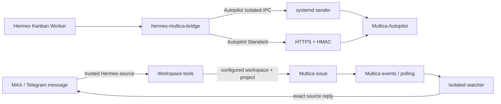

# Hermes Multica Bridge 0.2.0

`hermes-multica-bridge` is a Hermes plugin for two Multica workflows: sending the current pinned Kanban task to Autopilot and creating/managing Workspace issues from trusted MAX or Telegram message context.

Version 0.2.0 supports two security modes:

- **Standard** — the plugin sends HTTPS requests itself. Non-secret topology is stored in the profile's `ConnectionRegistry`; each Route's webhook/HMAC/PAT credentials are managed through the public Hermes plugin credential API and read at runtime only through `agent.secret_scope`.
- **Isolated** — the plugin never receives Multica secrets. Each new Route uses a separate socket-activated systemd sender instance with root-owned configuration and systemd credentials.

The Bridge is disabled by default: `enabled=false`. The model cannot spoof the message source, choose an arbitrary Workspace/project, or provide credentials, URLs, or attachment paths.

## Features

- Hermes tools with a narrow contract:
  - `multica_list_routes` — takes no arguments and lists only Routes allowed for the current message source and/or pinned Kanban worker;
  - `multica_send_task` — sends the current pinned Kanban task and accepts only an optional `route_id`;
  - `multica_check_task_result` — reads results only for a previously stored delivery and accepts only an optional `route_id`;
- Workspace routes with `multica_workspace_send`, `multica_workspace_get`, `multica_workspace_comment`, and `multica_workspace_update`;
- automatic issue creation in configured Workspaces/projects and attachment of available files from the current Hermes message;
- a separate restricted watcher that receives Multica events and sends updates to the exact original MAX or Telegram chat/thread;
- HMAC-SHA256 in the `X-Hub-Signature-256` header, computed over the exact bytes sent;
- a stable `Idempotency-Key` for each logical card version;
- bounded retries and a local SQLite ledger;
- strict HTTPS origin and webhook path validation; redirects and environment proxies are forbidden;
- any number of Connections, Workspaces, and Routes within one Hermes profile; tests cover at least 10 Routes;
- separate Standard credentials for each Route;
- separate Isolated instances with their own socket/config/state/credentials for every new Route;
- new result states are posted as deduplicated comments to the same Hermes Kanban task;
- profile state stores are created cleanly; unknown and previous internal schemas are rejected without migration.

## Architecture



In Isolated mode, the sender verifies Linux `SO_PEERCRED` and `SO_PEERPIDFD`, the allowed UID, the exact Hermes user-systemd path for the task/run-specific worker cgroup (`user-<uid>.slice/user@<uid>.service/app.slice/...scope`), the task ID from the Hermes worker's launch arguments, the cgroup's root process, and its direct parent in the precisely configured Gateway systemd unit before making an external request. Pidfds pin the original peer and its Gateway parent during these checks; after reading the cgroup, the sender rechecks the worker's PPID and the parent's liveness. Model subprocesses do not cross this boundary: their PID, parent, and launch arguments differ from those of the trusted worker process.

The current architecture does not require a manual allowlist of individual card IDs by default: authorization applies to the **current pinned Kanban task** that Hermes is already executing. Trusted context includes the board, task ID, current run ID, `task_runs.profile`, assignee, status, and the Gateway-recorded `worker_pid`; the task and run must identify the current plugin process PID. Route policy limits `source_boards` and profile/assignee and can require an exact OperatorGrant `(board, task_id, route_id)`. Standard reads the canonical task from pinned Kanban state, while Isolated also compares `task_id` with the worker's unchanged launch arguments and `task_id`/`run_id` with the exact worker cgroup.

## Trusted payload

The model can pass only an optional `route_id` to the send/result tools. URL, Workspace, Autopilot, trigger, credentials, and task body are not accepted as arguments. The Bridge reads `HERMES_KANBAN_BOARD`, `HERMES_KANBAN_TASK`, `HERMES_KANBAN_RUN_ID`, and the pinned Hermes Kanban DB, then builds:

```json
{
  "source": {
    "system": "hermes",
    "board": "example-board",
    "task_id": "task-id",
    "run_id": "worker-run-id"
  },
  "task": {
    "title": "Card title",
    "body": "Card text"
  }
}
```

`request_fingerprint` excludes the worker `run_id`, so a repeated worker run for the same unchanged card keeps one logical request and the same idempotency key. If the card title/body changes after delivery, result lookup ends with `request_conflict`.

## Standard

### Configuration

Non-secret topology is configured in the native Desktop **Registry**:

- Connection: `connection_id`, name, `multica_origin`, security mode, shared HTTP/rate-limit/HMAC policy;
- Workspace: `workspace_key`, `connection_id`, external `workspace_id`;
- Route: `route_id`, Connection/Workspace, Autopilot, trigger, event, source/profile/assignee/grant policy, and result tracking.

Each Route has its own write-only `webhook|hmac|pat` credentials. The public `ctx.credentials` API passes only the plugin ID, UUIDv7 Route ID, and fixed credential type to Hermes; Hermes computes the opaque environment variable name, stores/deletes the value in the selected profile scope, and returns only its presence. This API does not expose secret values or accept arbitrary environment variable names.

## Workspace Bridge

A Workspace route is always bound by configuration to one `workspace_id` and a required `project_id`. The tools do not accept `platform`, author, chat, thread, or message ID as model arguments. In the target Hermes build, the plugin reads these fields from the session context bound to the current Gateway turn and compares `get_session_env()` with `get_bound_session_env()` so that stale process environment values are not used. Incomplete or inconsistent context stops the operation before any Multica write request. A route is authorized only when platform, user ID, and chat ID match. Group, channel, and thread access is disabled until an operator explicitly enables it in policy.

A redacted single-profile template with four disabled Workspace routes and a separate Autopilot example is in [config/registry.om73.example.json](config/registry.om73.example.json). Replace `REPLACE-*` values only in local configuration.

Workspace routes run in Standard mode and use separate profile-scoped Multica PAT credentials. `allowed_assignees` uses `{id,type,label}` objects with type `member`, `agent`, or `squad`; external IDs must be canonical UUIDs. `default_assignee` must match an allowed pair. Legacy strings load as `member` and expose `legacy_assignee_entry` in `multica_list_routes` and the Dashboard. Autopilot continues to accept its existing string Hermes assignees.

`multica_workspace_send` creates an issue; a parent must belong to the same Workspace/project, and a subtask assignee is selected from the typed allowlist. An ID without a type is resolved only when exactly one match exists. Without an assignment, the operation is rejected before POST unless `allow_unassigned=true`; an unassigned issue returns `ok:false`, sends one notice to the current chat through public `ctx.post_message()`, and is not reported as started work. Reads, comments, and updates recheck that the issue belongs to the route. With `require_assignee=true`, an assignment cannot be removed; inviting members is not supported.

Only files from `get_current_attachments()` for the current Hermes turn are attached automatically. The plugin checks platform/chat/author/message ID, MIME type, extension, count, and size. The path comes only from a trusted Hermes descriptor, never from model arguments; the file is opened without following symlinks, and its identity and metadata are checked before and after reading. Data is sent to Multica from memory, no temporary file is created, and the path is not included in a response or log. This Hermes build's helper does not provide images, so they cannot be attached; a route with `require_source_attachment=true` rejects a message if no suitable file is available.

Session context and attachment descriptors come from Hermes's internal `gateway.session_context` and are tracked as `T38-DEBT-3`: after each Hermes update, recheck the contract and run context/attachment regression tests. The plugin does not require local changes to `register_tool()` or `model_tools` and does not pass `pass_context`.

The ledger binds each write to a profile, route, and source message. After create/update, the plugin uses a separate GET to compare actual state with the request; if readback differs or is unavailable, it returns `assignee_verification_failed`, and a retry performs only GET, never a second POST. A confirmed operation returns its saved result.

After issue creation, the plugin writes `origin`, `origin_route`, and `created_by` metadata, plus HMAC-SHA-256 pseudonyms of the author and source message keyed from the route's profile-scoped Multica PAT, without raw user/chat/message IDs. `related_issue_ids` is validated locally and stored as a compact JSON string. For `test=true`, it writes `origin_test=true`; metadata failure does not undo the issue and returns one `metadata_incomplete` warning. An unknown metadata write outcome is never retried automatically.

The watcher is a separate `hermes-multica-watcher.service` process running as `om73-watcher`. It uses its own root-owned configuration, systemd credentials, and private SQLite state, and cannot access the Hermes home directory. The plugin registers a verified issue-to-source-message mapping through a Unix socket, where the peer UID is checked with `SO_PEERCRED`. The watcher reconnects to the WebSocket with backoff and also reconciles issues/comments by polling every 30–60 seconds. On the first reconciliation it suppresses comments created before the chat mapping was registered; later comments and changes are delivered only when a mapping exists.

Notification delivery records confirmed sends as `delivered`, proven rejections as `not_sent`, and lost responses after a possible send as `delivery_unknown`. Only an explicit HTTP 429 is retried on a later reconciliation; `delivery_unknown` is never retried. Telegram sends are paced per chat, while MAX keeps its existing pacing. A failed watcher mapping stays in the profile ledger and later authorized Workspace operations retry it from the stored source fields; `get` never maps an issue from its current caller context. If the platform cannot reply to the exact source message/thread, the notification is not sent to the parent chat.

Inbound Workspace support depends on an adapter in the target build that sets session context for each current message. The MAX inbound adapter and its correct source binding must be verified separately on the target Gateway. Outbound MAX watcher delivery is implemented separately.

The plugin runtime computes the same deterministic environment variable name and reads its value only through `agent.secret_scope.get_secret()`. One Hermes profile can contain multiple independent Multica Connections and Routes.

## Isolated

In Isolated mode, Route topology is stored in the registry, while an operator installs secrets and trusted OS/systemd settings outside Hermes. Each Route has its own instance. The instance ID is deterministic: `r-<route_id_without_hyphens>`.

A fresh installation uses:

```text
hermes-multica-bridge@<instance>.socket
hermes-multica-bridge@<instance>.service
/run/hermes-multica-bridge/<instance>.sock
/etc/hermes-multica-bridge/<instance>.toml
/etc/hermes-multica-bridge/credentials/<instance>/
```

Operator helper:

```bash
sudo python3 /opt/hermes-multica-bridge/deploy/configure_isolated_instance.py \
  --instance <route-instance-id> \
  --route-id <route-id> \
  --connection-id <connection-id> \
  --workspace-key <workspace-key> \
  --route-policy-fingerprint <route-policy-fingerprint>
```

The Desktop displays the full command with non-secret Route identity. The helper verifies that `instance` matches `route_id`, prompts for secrets interactively with echo disabled, and creates root-owned configuration/credentials and a socket drop-in for the selected Hermes OS user. The socket unit creates `/run/hermes-multica-bridge` as a root-owned parent, and each instance gets its own socket. After checking the files, the operator separately runs `systemctl daemon-reload` and enables the instance socket.

Details: [deploy/README.md](deploy/README.md).

## Hermes UI

The unified package contains three surfaces:

- `plugin.yaml` + Python plugin — Hermes Autopilot and Workspace tools;
- `dashboard/` — web dashboard tab;
- `desktop/plugin.js` — a native Desktop page registered through the public `ROUTES_AREA`/`SIDEBAR_NAV_AREA` SDK.

The native Desktop shows **Overview**, **Registry**, and **Diagnostics** for the focused session's profile (falling back to the gateway profile). The Registry can create multiple Connections/Workspaces/Routes, set exact OperatorGrants, rotate route-scoped Standard credentials, and provide commands for a specific Isolated Route.

The backend rejects enabling a Route until required destination/policy fields and per-route readiness are complete. On first enable, the Route destination is locked; an enabled or used Route cannot be deleted or redirected, and retirement uses disable + tombstone. For Isolated, the dashboard runs a local `readiness` probe through the route-specific socket; it makes no HTTP request to Multica and returns no secret values.

The custom UI shows only secret presence and safe status. Profile/generation guards prevent a late status/save/credential response from changing another profile's state, including after an A→B→A profile switch.

## HMAC and HTTPS

For each webhook:

1. JSON is serialized once into `raw_body`.
2. HMAC-SHA256 is calculated over those same `raw_body` bytes.
3. `X-Hub-Signature-256: sha256=<hex>` is sent.
4. A stable `Idempotency-Key` is sent.
5. The HTTP request sends the exact bytes that were signed.

The client accepts only an HTTPS URL with the same origin as `multica_origin` and an allowed Multica webhook path. Userinfo, query, fragment, redirects, and environment proxies are forbidden. `request_timeout_seconds` sets one absolute monotonic deadline for DNS, connect/TLS, HTTP headers, and body reading, not separate socket waits. DNS runs in a bounded daemon resolver; at most four stuck system lookups are allowed at once. After that limit is reached, new requests end at their own deadline without creating more resolver threads.

HMAC is enabled by default. In Standard mode, the operator may explicitly disable `hmac_enabled`, leaving the bearer webhook URL. A new Isolated Route requires HMAC and fails closed if an attempt is made to enable it without HMAC.

## Result retrieval

With `result_tracking_enabled=true`, a separate read-only Multica PAT is required.

`multica_check_task_result`:

1. reads the current pinned Hermes task again;
2. finds its ledger record;
3. uses only the `run_id` saved at webhook delivery and the original Route's immutable destination snapshot;
4. reads the Multica run and related Issue/comments using the saved `multica_origin`/`autopilot_id`, even if the Route has since been disabled or tombstoned;
5. normalizes the status;
6. orders changes to one status using the monotonic Multica `Issue.revision` and prevents stale rollback;
7. reserves a comment in the ledger for a new status;
8. while that reservation is fresh, prevents the next result snapshot from overtaking the comment publication;
9. writes a bounded comment to the same Hermes task;
10. confirms the reservation only after a successful write.

Rechecking the same result does not create a duplicate. If writing the comment fails, the reservation is released and the next check can retry publication.

Normalized statuses: `pending`, `accepted`, `running`, `succeeded`, `failed`, `skipped`, `unknown`.

Webhook `accepted` means only that Multica accepted the delivery/created a run. It does not mean the task is complete.

## Local ledger

The SQLite ledger stores only the delivery and result state that is needed:

- route-scoped partition key;
- immutable snapshot: `route_id`, `connection_id`, `workspace_key`, external `workspace_id`, `multica_origin`, `autopilot_id`, `trigger_id`, security mode, and route/policy fingerprint;
- request/delivery/run/issue/task IDs;
- fingerprint/idempotency state;
- attempts/rate-limit state;
- result fingerprint and comment reservation state.
- the latest server-side Issue revision used to order result snapshots.

Webhook URLs, PATs, HMAC secrets, and secret response bodies are not stored in the ledger.

## Configuration lifecycle

The plugin is version 0.2.0. The registry accepts the current canonical structure; state stores are created from scratch, and incompatible SQLite schemas are rejected without migration or internal versioning.

Switching between Standard and Isolated does not transfer secrets automatically. A new mode is enabled only after its own readiness check. Enabling a Route locks its destination; use a new Route for another destination and disable + tombstone the previous one.

## Requirements

- Linux with systemd for the watcher and Isolated sender;
- Python 3.11+;
- Hermes Agent 0.22.4 or later with `gateway.session_context.get_bound_session_env`, `get_session_env`, and `get_current_attachments` available in the target build; the MAX/Telegram adapter must bind this data to the current turn;
- Linux 6.5+, systemd, unified cgroup v2, `SO_PEERCRED`, and `SO_PEERPIDFD` for Isolated mode only;
- an HTTPS Multica endpoint;
- a Multica PAT for Workspace API and the watcher; a read-only PAT for Autopilot result tracking;
- `websockets` for the Multica WebSocket watcher.

## Local verification

The main offline suite makes no live Multica requests and uses fake credentials/mocked HTTP.

```bash
python3 -m unittest discover -s tests -v
node --test tests/test_desktop_profile_guard.mjs tests/test_desktop_registry_ui.mjs
python3 -m compileall -q bridge dashboard deploy tests
```

The release gate also includes Ruff, Bandit, package build/metadata checks, Hermes plugin validate/doctor on a clean staging copy, `systemd-analyze verify`, a secret/personal-data scan, and project Thermos/Autoreview.

## Development status

The product version is 0.2.0. This extends the first plugin release without internal Registry, state-store, or API versions. Server installation, live Multica writes, commit/push, and publication are separate stages.

## License

The project is distributed under the **Omsk Open License — Base Modification. Attribution.**

The full English text is in [LICENSE.md](LICENSE.md).

## Hermes compatibility

Workspace does not require a paired Hermes core patch. To work with the target custom build, the plugin reads source context and current attachment descriptors through Hermes's internal `gateway.session_context`; this seam is tracked as `T38-DEBT-3`.

Three limited technical debts remain: `bridge/hermes.py` uses the private Kanban DB API only to check `worker_pid`, which is not exposed by `kanban_show`; `dashboard/plugin_api.py` uses `plugins_settings` because the dashboard route receives no `PluginContext`; and Workspace uses the internal Gateway session context because plugin tools receive no `tool_context`. After each Hermes update, run `plugins validate`, `plugins doctor --ci`, the `kanban_show`/`kanban_comment` tests, the Dashboard registry test, and the Workspace source/attachment tests. These debts can be removed when the corresponding public APIs become available.

Inbound MAX depends on a suitable MAX adapter being available in the Hermes build in use.
